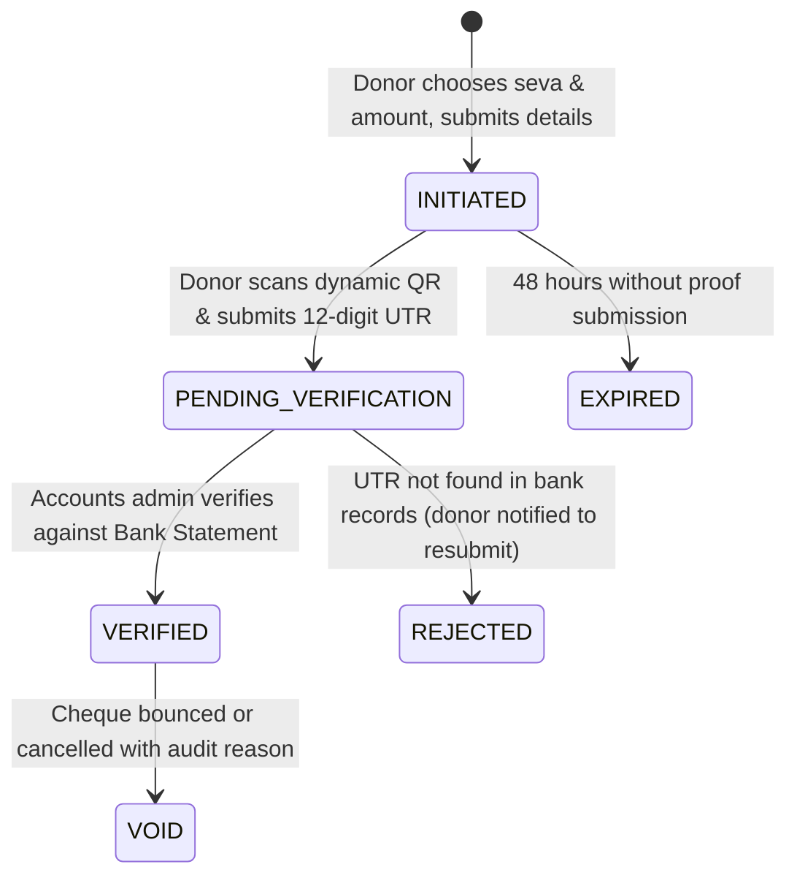

# Operating Direct Payments Without a Payment Gateway

## 1. Philosophy & Rationale

Commercial payment gateway aggregators (Razorpay, Cashfree, PayU, PhonePe PG) charge between **1.8% to 2.5% + GST** per transaction and require commercial merchant documentation that small heritage trusts and religious charities often struggle to maintain initially.

Furthermore, standard UPI payment requests (`upi://pay`) allow donors to send money directly from their bank account to the trust's official bank account without passing through third-party escrow accounts.

**The Fundamental Principle**:
> A UPI QR code or deep link only *requests* a payment from the donor's banking app. Without a gateway or banking aggregator API, an external server has no real-time notification that money was actually debited and credited.
> Therefore, the platform records the donor's intent, provides exact dynamic payment instructions with a traceable reference ID, collects transaction proof (the 12-digit UPI UTR number and optional screenshot), and an authorised accounts volunteer verifies the transaction against the trust bank statement. Only upon verification is the contribution counted in financial totals and the official tax receipt issued.

---

## 2. Donor Payment Lifecycle



1. **`INITIATED`**:
   - Donor chooses cause (Seva), preset or custom amount, and fills basic details.
   - Server allocates a unique reference code (e.g., `KSDHF-7K3Q9M`) and a private `donorToken`.
   - Dynamic UPI URI is generated:
     `upi://pay?pa=<vpa>&pn=<payee>&am=<amount.00>&cu=INR&tn=<refId+sevaCode>`
2. **`PENDING_VERIFICATION`**:
   - Donor scans the QR, clicks "Pay with UPI app" on mobile, or completes an IMPS/NEFT transfer.
   - Donor enters their 12-digit UPI UTR number (or bank reference) and optionally attaches a screenshot.
   - Automated email sent to donor: *"Payment details received, verifying within 1–2 working days."*
3. **`VERIFIED`**:
   - Admin opens the Pending Verification Queue.
   - Checks netbanking for the credit matching the Reference ID or UTR.
   - One-click verification triggers an atomic database transaction that allocates a gapless receipt number and automatically generates and emails the PDF receipt.

---

## 3. Dynamic UPI QR Technical Specification

Standard UPI specifications (NPCI) support dynamic URI parameters:
- `pa`: Primary VPA / UPI ID of the trust (e.g. `trust@bank`)
- `pn`: Payee legal name (URL encoded)
- `am`: Amount with 2 decimal places (e.g. `2100.00`)
- `cu`: Currency (always `INR`)
- `tn`: Transaction note containing the unique Reference ID and seva abbreviation (e.g. `KSDHF-7K3Q9M TemplePreserv`)

*Note*: We intentionally do not rely on `tr` (Transaction Reference) or `mc` (Merchant Category Code) as standard consumer UPI apps frequently strip `tr` when paying into non-merchant or personal trust accounts, while `tn` is universally preserved in bank narrations.

---

## 4. Fraud Prevention & Data Integrity Safeguards

1. **Unique UTR Index**:
   - Verified donations enforce a database constraint on the UTR number to prevent multiple donors claiming the same bank credit.
2. **Amount Discrepancy Correction**:
   - If a donor initiates a pledge for ₹1,100 but pays ₹2,100, the verification administrator can adjust the `receivedAmountPaise` field before issuing the receipt. The receipt will reflect the exact money received in the bank account.
3. **Receipt Immutability**:
   - Issued receipts are never deleted. If an entry must be cancelled, it is marked `VOID` with a mandatory reason, retaining an audit trail for the trust's chartered accountant.
4. **Rate Limiting & Honeypots**:
   - Submission forms include hidden anti-bot honeypot fields and IP-based rate limiting to protect against automated spam.

---

## 5. Gateway-Ready Abstraction Architecture

To ensure zero technical debt, the payment architecture is decoupled behind an extensible `PaymentProvider` interface:

```typescript
export interface PaymentProvider {
  createPaymentInstruction(donation: Donation): Promise<{
    method: PaymentMethod;
    qrUri?: string;
    instructions: string;
  }>;

  verifyPayment(donationId: string, proof: any): Promise<boolean>;
}

export class ManualUpiProvider implements PaymentProvider { ... }
```

### Future Gateway Integration (e.g., Razorpay or PhonePe)
When the trust obtains a merchant gateway account in the future:
1. Implement `RazorpayProvider implements PaymentProvider`.
2. Configure a webhook endpoint `POST /webhooks/razorpay`.
3. Upon receiving `payment.captured` webhook, verify the HMAC signature and call the existing internal verification service:
   `donationsService.verifyDonation(donationId, 'GATEWAY_AUTO')`.
4. The exact same gapless receipt counter, bilingual Devanagari PDF generator, and transactional email pipeline will execute automatically without modifying frontend layouts.
